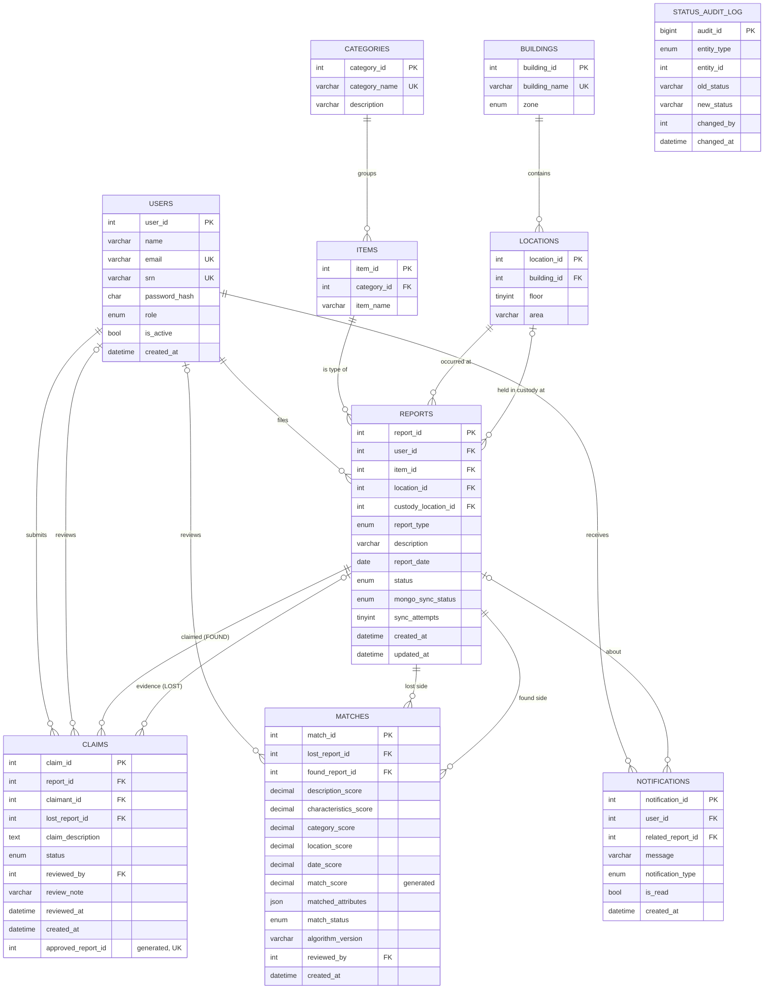

# FindIt — Phase 1: Requirements, Architecture & Database Design

> Status: **DRAFT FOR REVIEW**. No code is written until this design is approved.

---

## 0. Delivery plan (4 parts → 4 commits)

| Part | Covers (prompt phases) | Deliverables | Commit |
|---|---|---|---|
| **1. Design + Database layer** | Phase 1 + 2 | This doc, ER diagram source, `database/mysql/01-06`, seed generator, Mongo init + seed, `database/tests/db.test.js` | Commit 1 |
| **2. Backend** | Phase 3 | Next.js project, DB connections, auth, services (report, matching, claim, notification, sync), API routes, validation | Commit 2 |
| **3. Frontend** | Phase 4 | Landing, auth, dashboard, report form, browse, detail, claims, admin dashboard | Commit 3 |
| **4. Testing + Docs** | Phase 5 + 6 | End-to-end tests, bug fixes, README, API docs, test cases & results, screenshots, demo script | Commit 4 |

Note: the brief (item 15) says *"Commits should demonstrate individual contributions of team members."* Both members must author commits from their own Git identity for the work they personally did.

---

## 1. Requirements analysis (from the official brief)

| Brief item | How FindIt satisfies it |
|---|---|
| 1. Real-world problem, not CRUD | Weighted lost↔found matching engine, claim verification workflow, analytics |
| 3. SQL + NoSQL | MySQL (system of record) + MongoDB (flexible item attributes, search, activity log) |
| 4. ER diagram → relational schema; NoSQL data model, indexes, retrieval strategy | §4, §5, §6 |
| 5. DDL: CREATE, ALTER, DROP, PK/FK, constraints, indexes, views | `01_schema.sql` (DROP IF EXISTS + CREATE), `06_alter_migration.sql` (ALTER, DROP), §5 |
| 6. DML + JOIN, GROUP BY, HAVING, ORDER BY, aggregates, subqueries | Browse (JOINs), analytics (GROUP BY/HAVING), unresolved view (subquery), report deletion (DELETE) |
| 7. ≥ 4 advanced concepts | **9 planned**, see §8 |
| 8. Vector search (optional) | Architecture reserves an `embedding` field and `algorithm_version`; implemented in Part 4 if time allows (decision needed, §10) |
| 9–10. Next.js UI via API layer, env vars | Route Handlers → services → repositories; `.env.local` |
| 11. Auth, ≥ 2 roles | STUDENT, ADMIN; bcrypt + JWT in an httpOnly cookie |
| 12. Validation at **DB level** + integrity | CHECK, UNIQUE, FK, ENUM, validation triggers, generated-column uniqueness |
| 13. Security | Hashed passwords, parameterized queries, no secrets in code |
| 14. Documentation | README + `docs/` (incl. data dictionary, screenshots, test results, conclusion) |
| 17. Originality | Own schema (building/zone proximity model, explainable score breakdown, sync outbox) |

---

## 2. Functional requirements

### Students
- **FR-01** Register with name, university email, SRN, password. Log in and log out.
- **FR-02** Create a LOST or FOUND report: item type (category → item), short summary, detailed description, location, date, category-specific characteristics, up to 3 images.
- **FR-03** For FOUND reports, optionally record where the item is kept now (custody location, e.g. Security Office).
- **FR-04** Edit their own OPEN reports, close them (no longer needed), or delete them if no claims exist.
- **FR-05** Browse reports with full-text search and filters: type, category, location/building, date range, status. Results are paginated and sortable.
- **FR-06** View an item detail page: description, characteristics, images, location, date, status, potential matches.
- **FR-07** See potential matches for their reports, with a score breakdown and the matched attributes.
- **FR-08** Submit an ownership claim on someone else's OPEN FOUND report, optionally linking their own LOST report, with proof details.
- **FR-09** Track claim status (PENDING / APPROVED / REJECTED / WITHDRAWN) and withdraw a pending claim.
- **FR-10** Receive in-app notifications (new match, claim received, claim decided, report resolved) and mark them as read.
- **FR-11** Dashboard: my lost reports, my found reports, potential matches, pending claims, notifications.

### Administrators
- **FR-12** Approve or reject claims. Approval atomically resolves the found report and the linked lost report, rejects competing claims, confirms the match and notifies the users involved.
- **FR-13** Review matches: confirm or dismiss suggested matches.
- **FR-14** Manage users (activate/deactivate, promote to admin) and moderate reports (close).
- **FR-15** Manage buildings, locations, categories, item types and the category characteristic templates.
- **FR-16** Analytics dashboard:
  - totals and lost vs found counts
  - unresolved reports and successful recoveries
  - pending claims
  - top categories and top locations
  - monthly trends
  - most common colours and brands
  - recent activity
- **FR-17** View reports whose MongoDB sync failed and trigger a re-sync.

### System
- **FR-18** Run matching automatically when a report is created or edited, and store results in MySQL.
- **FR-19** Record every status change of reports, claims and matches in an audit log (DB triggers).
- **FR-20** Reconcile MySQL and MongoDB: retry failed writes and remove orphan documents.

### Non-functional requirements
- **NFR-1 Security:** bcrypt (cost 10+), RBAC on every API route, parameterized SQL, whitelisted Mongo operators, image MIME and magic-byte checks, 5 MB limit.
- **NFR-2 Integrity:** constraints enforced in the database, not only in the UI.
- **NFR-3 Performance:** indexed filters, and browse queries under 200 ms on seed data.
- **NFR-4 Usability:** responsive (mobile-first) UI with clear status badges.
- **NFR-5 Maintainability:** layered modules. Route handlers stay thin.
- **NFR-6 Portability:** runs locally with MySQL 8.0+ and Node 20+. MongoDB runs on **MongoDB Atlas (free M0 cluster)**, so there is no local install; only `MONGODB_URI` in `.env.local` changes. A local MongoDB 6+ also works unchanged.

---

## 3. System architecture

```mermaid
flowchart LR
  UI["Next.js App Router<br/>(React + Tailwind)"] -->|fetch /api/*| API["Route Handlers<br/>(auth guard + zod validation)"]
  API --> S1[ReportService]
  API --> S2[MatchingService]
  API --> S3[ClaimService]
  API --> S4[NotificationService]
  API --> S5[AnalyticsService]
  S1 --> SYNC[SyncService / Reconciler]
  S1 & S2 & S3 & S4 & S5 --> RMY[(MySQL repositories<br/>mysql2 pool)]
  S1 & S2 & S5 & SYNC --> RMO[(Mongo repositories<br/>mongodb driver)]
  RMY --> MY[(MySQL 8<br/>system of record)]
  RMO --> MO[(MongoDB<br/>item details / search / activity)]
  S1 --> FS[/uploads (disk)/]
```

**Layering:** `app/api/*` (HTTP only) → `lib/services/*` (business rules) → `lib/db/mysql/*`, `lib/db/mongo/*` (queries) → databases.

**Planned folder structure (implemented in Part 2):**
```
database/mysql/   01_schema.sql 02_functions_procedures.sql 03_views.sql 04_triggers.sql 05_seed.sql 06_alter_migration.sql
database/seed/    data.js (single source for both DBs) build-sql.js
database/tests/   db.test.js
database/mongo/   init.js  seed.js
docs/             01-design.md er-diagram.mmd api.md test-cases.md screenshots/
src/app/          (pages) + api/ (route handlers)
src/components/   UI components
src/lib/db/       mysql.js mongo.js + repositories
src/lib/services/ reportService matchingService claimService notificationService syncService analyticsService
src/lib/auth/     password.js session.js guards.js
src/lib/validation/ zod schemas
src/lib/utils/
```

**Libraries beyond the mandated stack (each one justified):**

| Library | Why it's needed |
|---|---|
| `mysql2` | MySQL driver. Supports prepared statements. |
| `mongodb` | Official MongoDB driver. |
| `bcryptjs` | Password hashing. |
| `jose` | Signs JWT session cookies. Works in Next.js middleware (edge runtime). |
| `zod` | Server-side input validation. |

No ORM: the project must show raw SQL.

---

## 4. ER diagram

### 4.1 Entities added to your proposed list, with justification

| Addition | Why |
|---|---|
| **Building** (split from Location) | `building → zone` would be a transitive dependency inside Location (3NF violation). Zone also drives the *location proximity* score. |
| **StatusAuditLog** | Target of the audit triggers (advanced concept). It keeps history even after a row is deleted, so it deliberately has no FK. |
| `Item` reinterpreted as an **item type catalogue** ("Water Bottle" under "Bottles & Flasks") | Normalizes item names. Gives a graded *category similarity* (same item type = 1.0, same category = 0.6). |

**No `Image` table:** images are a variable-length list of file metadata, so they live in MongoDB (§6).

### 4.2 Diagram



### 4.3 Relationships and cardinalities

| Relationship | Cardinality | Participation / notes |
|---|---|---|
| User **files** Report | 1 : N | Every report has exactly one owner |
| Category **groups** Item | 1 : N | Total on Item |
| Building **contains** Location | 1 : N | Total on Location |
| Item **is type of** Report | 1 : N | Total on Report |
| Location **occurred at** Report | 1 : N | Total on Report |
| Location **custody** Report | 1 : N | Partial: FOUND reports only, optional |
| User ⟷ Report via **Claim** | M : N with attributes | A user claims many found reports; a found report gets many claims. Unique per (report, claimant). |
| Report(LOST) **evidence for** Claim | 1 : N | Optional link to the claimant's own lost report |
| Report(LOST) ⟷ Report(FOUND) via **Match** | M : N (recursive) | Unique pair, and lost ≠ found |
| User(admin) **reviews** Claim / Match | 1 : N | Partial |
| User **receives** Notification | 1 : N | |
| Report **about** Notification | 1 : N | Optional |

---

## 5. Relational schema (MySQL 8, InnoDB, utf8mb4)

Notation: **PK** primary key, FK foreign key, UK unique key, NN not null.

### users
| Column | Type | Constraints |
|---|---|---|
| **user_id** | INT UNSIGNED AUTO_INCREMENT | PK |
| name | VARCHAR(100) | NN, CHECK `CHAR_LENGTH(TRIM(name)) >= 2` |
| email | VARCHAR(255) | NN, UK, CHECK `email LIKE '%_@_%._%'` |
| srn | VARCHAR(20) | UK, NULL allowed (admins), CHECK `role='ADMIN' OR srn IS NOT NULL` |
| password_hash | CHAR(60) | NN (bcrypt) |
| role | ENUM('STUDENT','ADMIN') | NN DEFAULT 'STUDENT' |
| is_active | BOOLEAN | NN DEFAULT TRUE |
| created_at | DATETIME | NN DEFAULT CURRENT_TIMESTAMP |

### categories
| **category_id** PK | category_name VARCHAR(60) NN UK | description VARCHAR(255) |
|---|---|---|

### items (item-type catalogue)
| Column | Type | Constraints |
|---|---|---|
| **item_id** | INT UNSIGNED AI | PK |
| category_id | INT UNSIGNED | NN, FK → categories ON DELETE RESTRICT |
| item_name | VARCHAR(80) | NN, UK(category_id, item_name) |

### buildings
| **building_id** PK | building_name VARCHAR(80) NN UK | zone ENUM('ACADEMIC','HOSTEL','FOOD','SPORTS','ADMIN','OPEN_AREA') NN |
|---|---|---|

### locations
| Column | Type | Constraints |
|---|---|---|
| **location_id** | INT UNSIGNED AI | PK |
| building_id | INT UNSIGNED | NN, FK → buildings ON DELETE RESTRICT |
| floor | TINYINT | NN DEFAULT 0, CHECK `floor BETWEEN -2 AND 15` |
| area | VARCHAR(100) | NN, UK(building_id, floor, area) |

### reports
| Column | Type | Constraints |
|---|---|---|
| **report_id** | INT UNSIGNED AI | PK (also the cross-DB link key) |
| user_id | INT UNSIGNED | NN, FK → users ON DELETE RESTRICT |
| item_id | INT UNSIGNED | NN, FK → items ON DELETE RESTRICT |
| location_id | INT UNSIGNED | NN, FK → locations ON DELETE RESTRICT |
| custody_location_id | INT UNSIGNED | NULL, FK → locations ON DELETE RESTRICT; CHECK `report_type='FOUND' OR custody_location_id IS NULL` (MySQL forbids CHECK on a column whose FK action is SET NULL/CASCADE) |
| report_type | ENUM('LOST','FOUND') | NN |
| description | VARCHAR(255) | NN short summary, CHECK `CHAR_LENGTH(TRIM(description)) >= 10` |
| report_date | DATE | NN, CHECK `report_date >= '2020-01-01'`; "not in the future" is enforced by a trigger (MySQL forbids `CURDATE()` in CHECK) |
| status | ENUM('OPEN','RESOLVED','CLOSED') | NN DEFAULT 'OPEN' |
| mongo_sync_status | ENUM('PENDING','SYNCED','FAILED') | NN DEFAULT 'PENDING' (transactional outbox flag) |
| sync_attempts | TINYINT UNSIGNED | NN DEFAULT 0 |
| created_at / updated_at | DATETIME | DEFAULT CURRENT_TIMESTAMP / ON UPDATE CURRENT_TIMESTAMP |

**Indexes:**
- `(report_type, status, report_date)`: browse filters
- `(user_id, report_type)`: dashboard
- `(item_id)`, `(location_id)`: joins and matching candidates
- `(status, created_at)`: unresolved and recent lists
- `(mongo_sync_status)`: reconciler

### claims
| Column | Type | Constraints |
|---|---|---|
| **claim_id** | INT UNSIGNED AI | PK |
| report_id | INT UNSIGNED | NN, FK → reports ON DELETE RESTRICT (must be a FOUND report; enforced by trigger) |
| claimant_id | INT UNSIGNED | NN, FK → users ON DELETE RESTRICT |
| lost_report_id | INT UNSIGNED | NULL, FK → reports ON DELETE SET NULL (must be the claimant's own LOST report; enforced by trigger) |
| claim_description | TEXT | NN (proof of ownership), CHECK length ≥ 20 |
| status | ENUM('PENDING','APPROVED','REJECTED','WITHDRAWN') | NN DEFAULT 'PENDING' |
| reviewed_by | INT UNSIGNED | NULL, FK → users ON DELETE RESTRICT (used by a CHECK) |
| review_note | VARCHAR(255) | NULL |
| reviewed_at | DATETIME | NULL; CHECK: PENDING/WITHDRAWN ⇒ reviewed_by and reviewed_at NULL; APPROVED/REJECTED ⇒ both set |
| created_at | DATETIME | DEFAULT CURRENT_TIMESTAMP |
| approved_report_id | INT UNSIGNED | **GENERATED ALWAYS AS (IF(status='APPROVED', report_id, NULL)) STORED, UNIQUE** |

`UK(report_id, claimant_id)` prevents duplicate claims. The generated unique column means **at most one APPROVED claim per report**, enforced by the database. MySQL has no partial unique index, and this is the standard workaround. Index: `(status, created_at)`.

### matches
| Column | Type | Constraints |
|---|---|---|
| **match_id** | INT UNSIGNED AI | PK |
| lost_report_id | INT UNSIGNED | NN, FK → reports ON DELETE CASCADE |
| found_report_id | INT UNSIGNED | NN, FK → reports ON DELETE CASCADE |
| description_score … date_score | DECIMAL(4,3) ×5 | NN, each CHECK `BETWEEN 0 AND 1` |
| match_score | DECIMAL(5,2) | **GENERATED STORED** = `ROUND(100*(0.35*d + 0.25*c + 0.15*cat + 0.15*loc + 0.10*dt), 2)`, indexed |
| matched_attributes | JSON | e.g. `["color: black", "sticker: red"]`, for explainability |
| match_status | ENUM('SUGGESTED','CONFIRMED','DISMISSED') | NN DEFAULT 'SUGGESTED' |
| algorithm_version | VARCHAR(20) | NN DEFAULT 'weighted-v1' (lets an embeddings model be swapped in later) |
| reviewed_by | INT UNSIGNED | NULL, FK → users ON DELETE SET NULL |
| created_at / updated_at | DATETIME | |

Constraints:
- `UK(lost_report_id, found_report_id)`: no duplicate matches. Re-matching uses `INSERT … ON DUPLICATE KEY UPDATE`.
- lost ≠ found is enforced by `trg_matches_bi` (MySQL forbids CHECK on columns used by a cascading FK)
- A trigger checks that the sides really are LOST and FOUND.

Storing `match_score` as a **generated** column avoids redundancy: the total is derived from its components and can never disagree with them.

### notifications
| Column | Type | Constraints |
|---|---|---|
| **notification_id** | INT UNSIGNED AI | PK |
| user_id | INT UNSIGNED | NN, FK → users ON DELETE CASCADE |
| related_report_id | INT UNSIGNED | NULL, FK → reports ON DELETE SET NULL |
| message | VARCHAR(255) | NN |
| notification_type | ENUM('MATCH_FOUND','CLAIM_RECEIVED','CLAIM_APPROVED','CLAIM_REJECTED','REPORT_RESOLVED','SYSTEM') | NN |
| is_read | BOOLEAN | NN DEFAULT FALSE |
| created_at | DATETIME | DEFAULT CURRENT_TIMESTAMP |

Index: `(user_id, is_read, created_at)`.

### status_audit_log (trigger-maintained)
| Column | Type | Constraints |
|---|---|---|
| **audit_id** | BIGINT UNSIGNED AI | PK |
| entity_type | ENUM('REPORT','CLAIM','MATCH') | NN |
| entity_id | INT UNSIGNED | NN (no FK by design: the audit must survive deletion) |
| old_status / new_status | VARCHAR(20) | old is NULL on insert |
| changed_by | INT UNSIGNED | NULL. Comes from the session variable `@app_user_id`, which the backend sets on the connection before each write. |
| changed_at | DATETIME | DEFAULT CURRENT_TIMESTAMP |

Index: `(entity_type, entity_id, changed_at)`.

### Normalization
- **1NF:** atomic columns only. Multi-valued data (images, tags, characteristics) goes to MongoDB instead of comma-separated columns.
- **2NF:** every table has a single-column surrogate PK, so there are no partial dependencies.
- **3NF/BCNF:**
  - Building → zone is split out of Location.
  - Item → category is split out of Report.
  - Report stores no counts or names that can be derived.
  - `match_score` and `approved_report_id` are generated columns, not stored duplicates.

### Referential actions, summarised
- `RESTRICT` where losing history would be wrong: users, reports with claims, catalogue rows in use. Users are deactivated, not deleted.
- `CASCADE` for dependent, derived data: matches when a report is deleted, notifications when a user is deleted.
- `SET NULL` for optional references.

---

## 6. MongoDB design (database `findit`)

### 6.1 Collection `item_details` (one document per report)
```json
{
  "_id": ObjectId("..."),
  "report_id": 101,
  "report_type": "LOST",
  "item_name": "Water Bottle",
  "category_id": 3,
  "category_name": "Bottles & Flasks",
  "building_name": "Central Library",
  "report_date": ISODate("2026-10-28"),
  "description": "Black Milton Thermosteel bottle, 1 litre, red sticker of a guitar near the cap. Left on the ground-floor reading table around 3 pm.",
  "characteristics": {
    "color": "black",
    "brand": "Milton",
    "material": "steel",
    "capacity": "1 litre",
    "sticker": "red guitar sticker"
  },
  "search_tags": ["water bottle", "black", "milton", "steel", "red sticker", "guitar"],
  "tokens": ["black", "milton", "thermosteel", "bottle", "litre", "red", "sticker", "guitar", "cap", "reading", "table"],
  "images": [
    { "file": "a3f9c2e1.webp", "mime": "image/webp", "size": 184233, "uploaded_at": ISODate("...") }
  ],
  "embedding": null,
  "schema_version": 1,
  "created_at": ISODate("..."),
  "updated_at": ISODate("...")
}
```

A laptop document has a different shape, with no forced common columns:
```json
{ "report_id": 117, "report_type": "FOUND", "item_name": "Laptop", "category_name": "Electronics",
  "characteristics": { "brand": "Dell", "model": "Inspiron 15", "color": "silver",
                       "specs": "i5, 15.6 inch", "identifying_marks": "PES sticker on lid, scratched corner" },
  "search_tags": ["laptop", "dell", "inspiron", "silver", "pes sticker"] }
```
A keys document:
```json
{ "report_id": 122, "characteristics": { "number_of_keys": 3, "keychain_color": "blue",
                                          "accessories": ["bottle opener", "Honda bike key"] } }
```

**Indexes:**
- `{ report_id: 1 }`, **unique**. This is the link key and makes upserts idempotent.
- **Text index** on `{ description, search_tags, item_name }` with weights `search_tags: 10, item_name: 8, description: 4`. Characteristic values are copied into `search_tags` at write time, so they are searchable too.
- `{ category_id: 1, report_type: 1, report_date: -1 }` for aggregations and match pre-filtering.
- `{ "characteristics.color": 1 }`, a sparse index for colour analytics and filters.

**Denormalized fields** (`report_type`, `category_*`, `building_name`, `report_date`, `item_name`): a write-once *search snapshot*. It lets text search and aggregation pipelines run without cross-database joins. These are facts that do not change after creation. **`status` is deliberately NOT copied**, because it changes, and MySQL is the only place it lives.

### 6.2 Collection `category_templates` (one document per category)
```json
{
  "category_id": 3,
  "category_name": "Bottles & Flasks",
  "fields": [
    { "key": "color",    "label": "Colour",   "type": "select", "options": ["black","blue","red","silver","green","pink","white","other"], "match_weight": 3, "required": true },
    { "key": "brand",    "label": "Brand",    "type": "text",   "match_weight": 3 },
    { "key": "material", "label": "Material", "type": "select", "options": ["steel","plastic","glass","copper"], "match_weight": 2 },
    { "key": "capacity", "label": "Capacity", "type": "text",   "match_weight": 1 },
    { "key": "sticker",  "label": "Stickers / marks", "type": "text", "match_weight": 3 }
  ],
  "updated_at": ISODate("...")
}
```
This drives the **dynamic report form** and the **per-attribute weights** in characteristic matching. Index: `{ category_id: 1 }` unique.

### 6.3 Collection `report_activity` (append-only event log)
```json
{ "report_id": 101, "event": "MATCH_RUN", "actor_id": null, "at": ISODate("..."),
  "data": { "candidates": 14, "stored": 2, "best_score": 80.9 } }
{ "report_id": 101, "event": "EDITED", "actor_id": 12, "at": ISODate("..."),
  "data": { "changed": ["characteristics.sticker", "images"] } }
{ "report_id": 117, "event": "VIEWED", "actor_id": 31, "at": ISODate("...") }
```
Index: `{ report_id: 1, at: -1 }`. Shown as the "Activity" timeline on the item page and the admin "recent activity" feed.

### 6.4 Why each piece lives in MongoDB

| Data | Why not MySQL |
|---|---|
| `characteristics` | The attribute set differs per category and is user-extended. In SQL it would need an EAV table (`report_attributes(report_id, key, value)`), which is hard to query, untyped, and needs many self-joins. |
| `category_templates` | A nested, ordered list of field definitions with options. It is configuration, read whole and edited whole: a natural document. |
| Long `description`, `search_tags`, `tokens` | Free text. The Mongo text index gives weighted relevance across fields. |
| `images[]` | Variable-length list of metadata, always read together with the item. |
| `report_activity` | High-volume, append-only events with different payload shapes per event type. It is not involved in any relational integrity rules. |
| `embedding` (future) | A large numeric array. It sits beside the text it encodes. |

**What stays in MySQL:** anything with relationships, ownership, or a lifecycle that needs integrity guarantees. That covers users, reports and their status, claims, matches, notifications and the audit log.

---

## 7. How MySQL and MongoDB interact

**Link key:** MySQL `reports.report_id` ↔ Mongo `report_id` (unique index). There is no cross-database FK. The backend owns the relationship.

### 7.1 Write path: creating a report (consistency strategy)
1. **MySQL transaction:**
   - Run `SET @app_user_id`.
   - `INSERT INTO reports (…, mongo_sync_status='PENDING')`.
   - The trigger writes the audit row.
   - `COMMIT`, which returns `report_id`.
2. **MongoDB:** `updateOne({report_id}, {$set: …}, {upsert: true})` writes the details document. Because it is idempotent, retries are safe. It also appends a `CREATED` activity event.
3. **Success:** `UPDATE reports SET mongo_sync_status='SYNCED'`, then run the matching engine.
4. **Failure:** `UPDATE reports SET mongo_sync_status='FAILED', sync_attempts=sync_attempts+1`. The user still gets their report, which is visible with its MySQL summary and shown as "details syncing".
5. **Reconciler (`syncService`):**
   - Re-pushes PENDING/FAILED rows. It runs on server start, every 5 minutes (in-process timer), and from the admin "Re-sync" button. The raw payload of the failed write is kept in a small local retry file.
   - Deletes **orphan** Mongo documents whose `report_id` no longer exists in MySQL.
   - Rows with more than 5 attempts are flagged on the admin dashboard.

Strategy name: **MySQL-first, outbox flag, idempotent upsert, eventual consistency for details**. MySQL is never rolled back because of a Mongo failure, since the authoritative record already exists.

**Delete path:** MySQL `DELETE` happens first (matches cascade), then Mongo `deleteOne`. If the Mongo delete fails, the reconciler's orphan sweep removes the document later.

### 7.2 Read paths
| Use case | Flow |
|---|---|
| Browse with keyword | Mongo `$text` returns report_ids ranked by `textScore` → MySQL `v_report_card WHERE report_id IN (…) AND status/date/location filters` (authoritative status) → merge in Mongo order |
| Browse without keyword | MySQL query with filters and pagination → Mongo `find({report_id: {$in}})` for thumbnails |
| Item detail | MySQL (report, owner, location, matches, claims) + Mongo (description, characteristics, images, activity) in parallel |
| Analytics | SQL views and procedures for counts and recoveries. Mongo aggregation for attribute-level stats and trends. |

### 7.3 Matching engine (`matchingService`, algorithm `weighted-v1`)
**Trigger:** after a report is created or edited and synced.

**Candidates:**
- **MySQL:** opposite type, `status='OPEN'`, different `user_id`, `report_id <> new id`, `ABS(DATEDIFF) <= 30`, and either the same category or the report ID came back from a Mongo `$text` search on the new report's tags.
- The candidate pool is limited to 200.

**Scores (each 0–1):**

| Component | Weight | How it's computed |
|---|---|---|
| Description | 35% | Jaccard similarity of normalized token sets (lowercase, stop-words removed, tags included) |
| Characteristics | 25% | Over keys present in **both** docs: Σ weight of keys whose normalized values match (exact or substring) ÷ Σ weight of compared keys, using template weights. 0.5 (neutral) if no comparable keys. |
| Category | 15% | Same item type 1.0, same category 0.6, else 0 |
| Location | 15% | SQL function `fn_location_proximity`: same location 1.0, same building and floor 0.8, same building 0.6, same zone 0.3, else 0 |
| Date | 10% | `max(0, 1 − |Δdays|/14)`. 0 if the item was "found" more than 1 day *before* it was lost. |

**Final score** = 100 × the weighted sum, computed by the generated column.
- Score ≥ 40: stored as SUGGESTED with `matched_attributes`.
- Score ≥ 60: both users are notified.
- Upsert on the unique pair, so there are no duplicates.

**Worked example** (the bottle from the brief):
- Description: shared tokens {black, bottle, red, sticker, library} / union of 9 = 0.56
- Characteristics: color, material and sticker all match = 1.0
- Category: same item = 1.0
- Location: Library, same building and floor = 0.8
- Date: 1 day apart = 0.93

**Score = 100 × (0.196 + 0.25 + 0.15 + 0.12 + 0.093) = 80.9.** The UI explains it as: "Matched: colour black · material steel · red sticker · same item type · same building · 1 day apart".

**Extensibility:** the scorer interface is `score(lostDoc, foundDoc) → {components, matched}`. A `semantic-v2` scorer could swap the description component to cosine similarity over `embedding`, recorded in `algorithm_version`.

---

## 8. Advanced database concepts (9 planned; the brief needs 4)

| # | Concept | Implementation | Where the app uses it |
|---|---|---|---|
| 1 | **Transactions** | `sp_approve_claim` (`START TRANSACTION`, `SELECT … FOR UPDATE` on report and claims, approve one, reject competitors, resolve the found and linked lost reports, confirm the match, insert notifications, `COMMIT`; `ROLLBACK` + `SIGNAL` on conflict). App-level `beginTransaction` for report creation and match persistence. | Admin approves a claim. Two admins approving competing claims at once: one succeeds, the other is rejected. |
| 2 | **Triggers** | `trg_reports_bi` (no future dates, custody only on FOUND); `trg_claims_bi` (only on OPEN FOUND reports, claimant ≠ finder, linked report must be the claimant's own LOST report); `trg_matches_bi` (type check); `trg_reports_au`, `trg_claims_au`, `trg_matches_au` (status → audit log) | DB-level validation (brief item 12) + the activity/audit page |
| 3 | **Views** | `v_report_card` (5-table JOIN), `v_active_lost_reports`, `v_unresolved_reports` (age in days, pending claim count and best match score via correlated subqueries), `v_recovery_stats` (GROUP BY category, recovery rate, HAVING) | Browse, admin unresolved list, analytics |
| 4 | **Stored procedures / functions** | `sp_approve_claim`, `sp_reject_claim`, `sp_recovery_summary(from, to)` (multiple result sets), `sp_reports_by_user(user, type)`, `sp_reports_by_category(cat, status)`; functions `fn_location_proximity(a, b)`, `fn_days_open(report_id)` | Claims, admin summary, dashboard, matching engine |
| 5 | **Indexing** | Composite B-tree indexes in §5; `EXPLAIN` before/after shown in docs | Browse filters, dashboard, matching candidate query |
| 6 | **Generated columns + unique constraint** | `matches.match_score`, `claims.approved_report_id` | Explainable score; one-approved-claim rule enforced in the DB |
| 7 | **MongoDB text index (full-text search)** | Weighted text index on `item_details` | Browse search box, matching candidate expansion |
| 8 | **MongoDB aggregation** | `$match/$group/$sort` for top categories lost; `$group` by `building_name`; `$dateToString` monthly trend split by `report_type`; `$objectToArray` over `characteristics` for the most common colours and brands per category | Admin analytics charts |
| 9 | **DDL lifecycle (CREATE / ALTER / DROP)** | `01_schema.sql` uses `DROP … IF EXISTS` + `CREATE`; `06_alter_migration.sql` adds a column + CHECK, modifies an ENUM, adds an index, creates and drops a staging table | Brief item 5 |
| (opt) | **Vector similarity** | Embeddings for descriptions, cosine similarity | Only if you choose it (§10) |

**Required DML coverage:**
- **INSERT:** reports, claims, matches.
- **UPDATE:** status changes, mark notification read.
- **DELETE:** delete own report with no claims, delete notifications, admin removes unused location.
- **SELECT:** JOIN, GROUP BY/HAVING (categories with ≥ N unresolved reports), ORDER BY, aggregates, subqueries (reports with no match; users with more than 1 rejected claim).

---

## 9. Security design (summary)
- **Passwords:** bcrypt only; the hash never leaves the server.
- **Sessions:** JWT with `{user_id, role}` in an httpOnly, SameSite=Lax cookie. Middleware guards `/dashboard`, `/report`, `/admin`. Every API route re-checks the role and ownership on the server.
- **SQL:** `mysql2` `execute()` with placeholders only. Sort columns are whitelisted.
- **Mongo:** inputs validated with zod. User input never becomes an object key or operator (prevents `$where` / `$ne` injection). Characteristic keys are checked against the category template.
- **Uploads:** JPEG/PNG/WebP only, checked by magic bytes; ≤ 5 MB; at most 3 per report. Stored under random names outside `public/` and served through an authorized route.
- **Secrets:** everything comes from `.env.local`. `.env.example` is committed; `.env*` is gitignored.

---

## 10. Decisions needed from you
1. **Vector search (optional per brief §8).** Recommended: **skip for now**, keep the extensibility hooks, and add it in Part 4 only if time remains (local embeddings via `@xenova/transformers`, cosine similarity in app code).
2. **Item catalogue.** Report form = pick category → pick item type, with an "Other" item per category. OK?
3. **Claims only on FOUND reports.** A LOST report's owner can't be "claimed against"; the finder of a lost item contacts them through the match instead. OK?
4. **Seed data scale.** Around 25 users, 12 buildings, 40 locations, 10 categories, 45 item types, 80 reports, 15 claims. Realistic campus names (generic, not copied from any real map).
